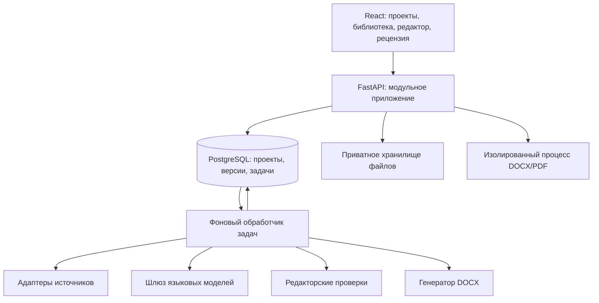

# Архитектура персональной Academic Research Studio

Статус: проект решения, 3 ноября 2026 года. Исходное основание: `main` на коммите `df2c07c`, [AGENTS.md](../AGENTS.md), [34 редакторских критерия](editorial-criteria.md). Порядок реализации и критерии приёмки — в [roadmap.md](roadmap.md). В `main` (`bc05bba`) объединены технический реестр P0 (раздел 8) и [первая поставка P1](projects.md): PostgreSQL, проекты и версии требований. В этой ветке реализован [P2: ручная структурная рукопись и версии](manuscripts.md). Остальные новые компоненты остаются проектом.

## 1. Цель и границы

Один исследователь ведёт работу от исследовательского вопроса до проверяемого DOCX: фиксирует задание, ищет и читает источники, собирает доказательства, строит план, пишет разделы, получает независимую рецензию и принимает изменения. Система помогает автору принимать решения и показывает происхождение каждого внешнего утверждения. Она не выдумывает ссылки, результаты экспериментов или исследовательские данные и не обещает результаты антиплагиата или «процент ИИ».

Начальные допущения: русский язык основного текста, русские и английские источники, один владелец, локальное развёртывание Linux/WSL. Персональные настройки включают дисциплину, жанр, язык, стиль цитирования, шаблон учреждения, терминологический словарь и бюджет модельных вызовов. Настройки фиксируются в версии проекта; изменение предпочтения не переписывает уже принятый текст. Все выводы о качестве зависят от жанра и задания.

## 2. Что работает сейчас и как это сохранить

| Существующий компонент | Наблюдаемое поведение | Совместимость при развитии |
| --- | --- | --- |
| `backend/app/main.py` | `GET /api/health`; `POST /api/documents/extract?filename=…` принимает бинарное тело | Сохранить маршруты, формат ответа и коды ошибок; новые операции добавлять отдельно |
| `backend/app/extract.py` | DOCX: основные абзацы и таблицы; PDF: текст с номерами страниц | Переиспользовать для импорта; не обещать полное восстановление структуры |
| `backend/app/worker.py` | Одноразовый subprocess; лимиты памяти/CPU, родитель ограничивает время | Разбор файлов остаётся изолированным от API и модельных задач |
| `frontend/src/App.tsx` | Выбор файла, загрузка, ошибки, просмотр текста | Сохранить самостоятельный режим извлечения без создания проекта |
| Тесты и CI | 19 backend-тестов, 4 frontend-теста, TypeScript и Vite build | Сохранить как регрессионную базу; дополнять проверками новых сценариев |

Текущие лимиты: файл 10 МиБ, PDF 200 страниц, извлечённый текст 1 000 000 символов, два запроса на процесс API; DOCX имеет дополнительные ZIP/XML-проверки. Ответ содержит `format`, `text`, `chunks[{text,page}]`, `pages`. Оригиналы и результат сейчас не сохраняются. Поля форматирования, устойчивые ID абзацев, колонтитулы и полные сноски отсутствуют. Оценивать критерий 24 (жирные выделения) по этому plain-text ответу нельзя.

Первая поставка P1 сохраняет проекты и требования только по действиям создания проекта/новой версии. Для будущего сохранения документов режим проекта будет требовать явного действия «Добавить в проект» с понятным сроком хранения. Старый маршрут остаётся временным и не требует PostgreSQL. При отказе БД он продолжает извлекать текст. Ни этот документ, ни PR не меняют существующий код и договорённость о приватности.

## 3. Путь пользователя

1. **Задание.** Тема, вопрос, жанр, объём, сроки, требования учреждения, допустимое использование ИИ и метод исследования. Для эмпирической работы — план сбора данных, ограничения и происхождение набора данных.
2. **Поиск.** Пользователь утверждает поисковые запросы и фильтры; система сохраняет результаты, дату поиска, включённые и исключённые источники с причинами.
3. **Чтение и доказательства.** Карточки источников, точные цитаты с локаторами, заметки, противоречия и пропуски. Отсутствие полного текста видно отдельно от наличия метаданных.
4. **План.** Структура работы и цель каждого раздела, карта «вопрос → тезис → доказательство → источник». Пользователь утверждает план.
5. **Написание.** Ручной редактор и генерация предложений по одному разделу из выбранных материалов. Без доказательств система оставляет задачу поиска или явный пробел, а не достраивает факт.
6. **Рецензирование.** Фиксируется версия рукописи. Отдельный запуск проверяет метод, доказательства, логику, ограничения и все применимые редакторские критерии.
7. **Редактирование.** Пользователь видит diff и основания, принимает или отклоняет каждое изменение; принятые правки создают новую версию и запускают повторные проверки затронутых мест.
8. **Экспорт.** Проверка ссылок, структуры и обязательных полей, выбор шаблона; Word-файл создаётся из зафиксированной версии вместе с отчётом о нерешённых замечаниях.

Переходы не являются автоматической цепочкой: можно вернуться к поиску после рецензии. Состояния проекта `brief → researching → outlining → drafting → reviewing → revising → ready` отражают рабочий этап. Статус `ready` назначает пользователь после просмотра отчёта; он не означает научную достоверность, установленную машиной.

## 4. Компоненты и развёртывание

Сначала модульный монолит FastAPI, один worker и PostgreSQL; микросервисы, отдельный брокер и векторная БД не нужны. Предлагаемые модули `projects`, `sources`, `evidence`, `manuscripts`, `reviews`, `editorial`, `exports`, `jobs` имеют отдельные сервисы и модели, но один репозиторий и транзакционную БД. Существующий parser остаётся отдельным ограниченным процессом.

Для схемы предлагаются SQLAlchemy и Alembic; версии и лицензии проверяются при внедрении. Задачи хранятся в PostgreSQL: захват через `FOR UPDATE SKIP LOCKED`, lease и heartbeat, ограниченные повторы с задержкой, состояние `queued/running/succeeded/failed/cancelled`. Worker может выполнить задачу повторно после сбоя, поэтому запись результата идемпотентна по `(project_id, operation, input_revision, configuration_hash, idempotency_key)`. Старый результат не заменяет более новую версию. Пользователь может отменить задачу; активный subprocess завершается, новые запросы к провайдеру не отправляются. Долгие HTTP-запросы возвращают `202` и ID задачи; UI сначала использует polling.

Для персональной установки файлы хранятся в закрытом каталоге за API, с непрозрачными ID, вне web-root. Интерфейс хранилища допускает S3-совместимую замену позднее. Поиск по своей библиотеке начинается с PostgreSQL full-text и фильтров; embeddings добавляются только после измерения качества поиска и с отдельным согласием на передачу текста.

## 5. Данные и происхождение текста

| Сущность | Основные поля и связи |
| --- | --- |
| Project / BriefRevision | Владелец, вопрос, жанр, язык, требования, профиль проверки, шаблон, бюджет; неизменяемые версии задания |
| Source / SourceVersion | DOI/ISBN/URL, авторы, название, год, тип, метаданные провайдера, дата получения, состояние проверки, лицензия/доступ, связи версий и ретракций |
| SearchRun / SearchHit | Запросы, провайдер, фильтры, время, позиция, source_id, решение о включении и причина |
| Asset / Extraction | Хеш оригинала, закрытый storage key, MIME, размер, права использования, parser version, предупреждения и блоки извлечённого текста |
| Evidence | source_version_id, точная цитата, страница/раздел/диапазон, контекст, заметка автора, статус проверки локатора |
| Claim / ClaimEvidence | Формулировка тезиса, тип (источник/собственные данные/интерпретация), поддерживает/опровергает/ограничивает, evidence_id либо ссылка на набор данных |
| Dataset / AnalysisRecord | Происхождение, лицензия/согласие, версии данных, метод и параметры расчёта, выводы; автоматическое исполнение исследовательского кода вне первого MVP |
| Outline / ManuscriptRevision | Дерево разделов; неизменяемый снимок документа, parent revision, автор изменения, content hash |
| Citation | Стабильный узел в рукописи, source_version_id, evidence_id, локатор и тип цитирования; библиография вычисляется по используемым узлам |
| ReviewRun / Finding | Версия текста/критериев/модели, покрытие, замечания, привязки, основания, уверенность, серьёзность и статус решения |
| ChangeProposal / Decision | Исходная версия, patch, основания, связанные замечания, авторское решение и resulting_revision |
| Export / Job / ModelRun | Входная версия, шаблон/стиль, результат/хеш, ошибки; модель, параметры, лимиты, расход, версия промпта без секретов |

Целевой внутренний документ — типизированное дерево блоков (заголовки, абзацы, списки, таблицы, цитаты, ссылки, сноски и поддерживаемые marks), а не HTML-строка. Каждый блок имеет устойчивый UUID. P2 реализует ограниченную схему 1: заголовки, абзацы, списки, прямоугольные таблицы, цитаты и отдельные заготовки ссылок; сноски и inline-citations ещё не реализованы. Выбран редактор блоков на существующем React без новых зависимостей; [решение и границы](manuscripts.md). ProseMirror остаётся кандидатом для последующего inline-редактирования.

Привязка замечания: `{revision_id, block_id, start, end, quote, quote_hash}`; диапазон полуоткрытый, единица — UTF-16 для совместимости с редактором JavaScript, backend конвертирует явно. Перед применением проверяются revision и текст диапазона. Конфликт возвращает `409`; перенос замечания на новую версию требует повторной проверки совпадения. Удалённый фрагмент делает замечание устаревшим. Хеши подтверждают неизменность данных, но не их истинность.

## 6. Источники и написание с нуля

Первые адаптеры: Crossref для DOI/метаданных, OpenAlex для поиска и связей, DOI resolver и страницы издателей для сверки. Это кандидаты интеграций, а не уже настроенные сервисы. До реализации проверяются актуальные API, квоты, лицензии, ключи и доступность; ISBN сверяется с каталогом библиотеки/издателя, причём контрольная сумма сама по себе не подтверждает книгу. Ручное добавление источника и импорт библиографических записей доступны при недоступности сервиса.

Разделять четыре вопроса: существует ли запись; доступна ли ссылка; получен ли нужный полный текст; поддерживает ли он тезис. Для каждой проверки сохранять `verified/unverified/conflict/unavailable`, время, провайдера и доказательство. HTTP 403, таймаут и paywall не означают вымышленный источник. Наличие DOI не гарантирует качество исследования. Дубликаты объединять по идентификатору, а слабое совпадение названий предлагать пользователю; сохранять происхождение конфликтующих метаданных.

Полные тексты получать из разрешённых открытых источников или от пользователя с правом использования. Не обходить ограничения доступа. Цитата должна совпадать с сохранённым фрагментом источника, локатор проверяется отдельно. Непроверенный пересказ абстракта не представлять как чтение всей статьи. Отрицательные результаты и противоречащие источники сохранять рядом с поддерживающими.

Генератор раздела получает утверждённый план, цель раздела, выбранные Evidence/Claim, терминологию и ограничения. Возвращает структурированные блоки и только ID разрешённых источников. Сервер отвергает несуществующий citation ID; модель не создаёт библиографическую запись из памяти. Проверка фактической поддержки тезиса остаётся отдельной от проверки ID. Пробелы вида «нужны данные» хранятся как задачи, а не маскируются придуманными числами. Ручное написание и правка работают без подключённой модели.

## 7. Независимая рецензия и цикл правок

Независимость здесь процедурная: рецензент запускается в новом контексте на неизменяемом снимке, видит задание, текст, метод, материалы и критерии, но не переписку генератора, его самооценку и предложенные оправдания. Входы и версии фиксируются. Отдельный провайдер/модель может повысить разнообразие оценки, но не доказывает независимость ошибок. UI честно показывает, если автор и рецензент использовали одну модель. Пользователь может провести человеческую рецензию по тому же протоколу.

Два прохода: содержательный (вопрос, метод, доказательства, альтернативные объяснения, ограничения, воспроизводимость, цитирование) и редакторский (34 критерия). Приоритеты: факты и воспроизводимость → аргументация → добросовестное цитирование → язык → оформление. Стилистические эвристики не заменяют научную оценку.

Рецензент имеет доступ только на чтение и возвращает замечания с цитатой, объяснением, доказательством/недостающими данными, серьёзностью `critical/major/minor/suggestion`, уверенностью `low/medium/high` и предложением действия. Уверенность — оценка обоснованности замечания, не вероятность происхождения текста. Невыполненные проверки явно обозначаются. Отсутствие замечаний не равно успешной проверке, если не было данных.

Редактор создаёт отдельные предложения изменений, не применяет их автоматически. Для каждого diff проверяются цитаты, атрибуция, числа, отрицания и квалификаторы; изменение факта требует повторной проверки доказательств. Пользователь принимает/отклоняет предложения с возможностью отмены через новую ревизию. Повторная рецензия отмечает `resolved/still_present/uncertain`, не закрывает замечание только по нажатию «принять». Число циклов и стоимость ограничены; при достижении бюджета работа сохраняется и ожидает решения автора.

## 8. Реестр и реализация всех 34 критериев

В P0 исправлена нумерация внутри пункта 32 и создан [версионированный JSON-реестр со строгой валидацией](editorial-registry.md). Документ содержит 34 уникальных заголовка 01–34. Отдельные `description` отсутствуют в источнике и явно представлены как `null` с `description_status: missing_in_source`; [содержательные вопросы](editorial-ambiguities.md) зафиксированы отдельно. Приоритет и исключения каждого пункта перенесены без изменения. Технический реестр реализован; методы проверки ниже остаются проектом.

Целевая модель будущих этапов `Criterion` (шире текущего реестра P0): строковый `id` (`01`…`34`), `name`, `description`, `signals`, `review_action`, `exceptions`, `version`, `required_inputs`, `applicability`. Проверка возвращает `candidate/no_issue/not_applicable/insufficient_data/error` и покрытие. Только `candidate` создаёт предложение замечания; пользователь подтверждает нарушение. Формальный сигнал не является достаточным основанием, исключения проверяются всегда. Численные частоты нормируются на размер раздела; пороги калибруются по корпусу, не задаются как универсальные нормы.

| ID | Критерий | Поиск сигнала и контекстная проверка | Необходимые данные / исключение |
| --- | --- | --- | --- |
| 01 | Необоснованная значимость и символизм | Оценочная лексика → сопоставление с фактическим эффектом и Evidence | Подтверждающий источник или анализ самой оценки |
| 02 | Ссылка на известность вместо анализа | Упоминания СМИ/наград → связь с тезисом | Цель раздела; исследование охвата допустимо |
| 03 | Поверхностный анализ | Абстрактные утверждения → поиск механизма, доказательства, контраргумента | Полный раздел; детализация может следовать после введения |
| 04 | Рекламная позитивная лексика | Словарь → проверка обоснования и цитат | Границы цитат; анализ рекламы допустим |
| 05 | Навязчивые дидактические оговорки | Повтор вводных фраз → необходимость предупреждения | Контекст ограничения метода |
| 06 | Дублирование содержания в итоговом разделе | Текстовое/смысловое сходство → наличие синтеза | Основной текст, заключение, требуемое резюме |
| 07 | Шаблон «достижения — проблемы — перспективы» | Сходство концовок разделов → связь выводов с данными | План и предмет работы; обоснованная схема допустима |
| 08 | Заголовок искусственно объявлен термином | Совпадение заголовка с определением → проверка терминологии | Источник определения либо авторская операционализация |
| 09 | Неработающие внешние ссылки | Ограниченный HTTP-запрос, редиректы → соответствие документа | Время проверки, ответ сервера; сбой означает «не проверено» |
| 10 | Некорректные DOI и ISBN | Синтаксис/контрольная сумма → сверка метаданных | Реестр/издатель/каталог; отсутствие ID не нарушение |
| 11 | Лишние трекинговые UTM-параметры | Разбор URL → проверка семантики ссылки после удаления | Необходимые параметры сохраняются; удаление предлагается diff |
| 12 | Обращения к читателю как к собеседнику | Поиск служебных реплик → классификация контекста | Диалог, интервью, памятка исключаются |
| 13 | Неконкретные оговорки о знаниях и источниках | Неопределённые оговорки → наличие периода и границ данных | Корректно описанная неполнота сведений допустима |
| 14 | Шаблонные письма и ответы внутри исследования | Приветствия/шаблоны → роль фрагмента | Приложения с письмами и стенограммами допустимы |
| 15 | Перегруженные или нелогичные деепричастные обороты | Синтаксический разбор → соотнесение действия с субъектом | Русский синтаксис и контекст; корректный оборот сохраняется |
| 16 | Повторяющиеся параллельные противопоставления | Частота конструкций → аналитическая необходимость | Содержательное противопоставление допустимо |
| 17 | Искусственное «правило трёх» | Повтор трёхчастных перечислений → основание классификации | Реальные три категории сохраняются |
| 18 | Неопределённые авторитеты | Обобщённая атрибуция → поиск конкретной ссылки рядом | Следующее предложение и связанные Citation |
| 19 | Искусственная синонимизация терминов | Терминологические цепочки → эквивалентность понятий | Глоссарий; намеренно разные понятия не объединяются |
| 20 | Необоснованные крайности «от… до…» | Поиск диапазонов → сопоставимость и общая шкала | Единицы, предметная область; корректный диапазон допустим |
| 21 | Чужеродная Markdown-разметка | Лексический поиск → целевой формат и тип узла | Markdown-проект, код и цитаты учитываются отдельно |
| 22 | Несуществующие категории и технические метки | Плейсхолдеры/метки → сверка классификации | Справочник предметной области; явный черновик допустим |
| 23 | Неуместные заглавные буквы в заголовках | Регистр заголовков → язык, имена и стиль | Требования учреждения, официальные названия |
| 24 | Избыточные жирные выделения | Доля bold marks → роль смысловых акцентов | Нужна разметка; по plain text — insufficient_data |
| 25 | Однотипные вертикальные списки | Доля list-блоков с мини-заголовками → необходимость связного рассуждения | Жанр; инструкции, требования, чек-листы допустимы |
| 26 | Частое длинное тире как универсальный разделитель | Частота и синтаксические позиции → корректность пунктуации | Синтаксис; не вводить квоту тире |
| 27 | Ритмическая монотонность предложений | Длины и синтаксические формы → функция последовательности | Однотипные результаты могут требовать повторения |
| 28 | Слишком много одинаковых подпунктов | Сходство структуры разделов → целесообразность композиции | Иерархия разделов; справочники и классификации допустимы |
| 29 | Повтор схемы «тезис — пояснение — следствие» через пунктуацию | Паттерны двоеточий/скобок/тире → необходимость пояснений | Контекст определений и аргументов |
| 30 | Пустые акцентные заголовки | Словарь заголовков → назван ли предмет раздела | Справки и презентации исключаются |
| 31 | Частотные оценочные слова | Нормированная частота → доказанность ранжированной значимости | Доказательства и сравниваемые показатели |
| 32 | Формула «Это не просто X — это Y» | Поиск вариантов формулы → смысл различия X и Y | Реальное аналитическое противопоставление допустимо |
| 33 | Начальные указатели «вот», «это», «здесь» | Серии начал предложений → разрешение референта | Предыдущий контекст; естественная анафора допустима |
| 34 | Неуместные метафоры, эпитеты и сравнения | Контекстное выделение образности → жанр и объяснительная ценность | Художественный анализ и точные аналогии допустимы |

Близкие сигналы (01/31, 16/32, 25/28, 26/29) группируются в интерфейсе по фрагменту и основанию; ссылки на все применимые criteria IDs сохраняются. Не складывать замечания в искусственный единый «балл качества». Правила 23–25 требуют расширенного импорта структуры либо текста, написанного в редакторе. На старом импорте потерянные свойства не восстанавливаются догадками.

## 9. Контракты API и совместимость

Новые маршруты ниже — проект, а не существующие endpoints:

| Операция | Предлагаемый контракт |
| --- | --- |
| Проекты и задание | `POST /api/projects`, `GET /api/projects/{id}`, `POST /api/projects/{id}/brief-revisions` |
| Поиск и библиотека | `POST /api/projects/{id}/search-runs` → 202; `POST /api/projects/{id}/sources`; `POST /api/sources/{id}/verification-runs` |
| Доказательства | `POST /api/projects/{id}/evidence`, `POST /api/projects/{id}/claims` с проверкой принадлежности |
| Версии рукописи | `GET /api/projects/{id}/manuscript`, `POST /api/projects/{id}/revisions` с обязательной base_revision |
| Написание и рецензия | `POST /api/projects/{id}/draft-runs`, `POST /api/projects/{id}/review-runs` → 202, зафиксированные входы |
| Решения по правкам | `POST /api/change-proposals/{id}/decisions`; атомарная проверка версии, 409 при конфликте |
| Экспорт и задачи | `POST /api/projects/{id}/exports` → 202; `GET /api/jobs/{id}`; `POST /api/jobs/{id}/cancel` |

Pydantic-схемы задают обязательные поля, ограничения и перечисления. Общие ошибки новых маршрутов содержат code/message/retryable; старый `detail` сохраняется. OpenAPI используется для согласования типов frontend. Миграции БД сначала аддитивны; изменение семантики старого API требует отдельной версии и миграционного плана.

## 10. Word-экспорт

`python-docx` строит новый документ из ManuscriptRevision и версионированного шаблона: титульный лист, стили заголовков, абзацы, списки, таблицы, цитаты и библиография. Ссылки и список литературы формируются из Citation/SourceVersion через единый адаптер стиля; кандидат CSL-процессора выбирается после проверки лицензии и тестов выбранного ГОСТ/APA-профиля. ГОСТ не подразумевается универсальным: нужен точный стандарт и локальные требования.

Предэкспортная проверка выявляет dangling citations, незаполненные поля, неподдерживаемые узлы и устаревшую рецензию. Несуществующая citation-связь блокирует финальный экспорт; нерешённые содержательные замечания доступны в отчёте и требуют решения автора. Черновой экспорт возможен с явной пометкой и перечнем пробелов. Пользовательские заметки и модельные промпты в документ не попадают.

Оглавление и номера страниц могут требовать обновления полей в Word; сервер не обещает точную пагинацию без layout engine. Первый экспорт поддерживает ограниченный набор узлов и не является lossless round-trip исходного DOCX. Комментарии и Track Changes в Word — отдельный поздний этап; до него изменения доступны как diff в приложении. Приёмка: проверка OOXML, повторное чтение, сохранность Unicode, ссылок, таблиц и иерархии; ручное открытие в Word и LibreOffice.

## 11. Приватность, устойчивость и наблюдаемость

Локальный режим по умолчанию доступен только на loopback. Перед сетевым доступом — аутентификация владельца, TLS, защита сессии/CSRF и проверка прав на каждый project/asset/job. Хранилище и резервные копии закрыты; удаление проекта удаляет файлы, индексы и результаты, а срок удаления из резервных копий явно указан. Постоянное хранение и отправка провайдеру модели — разные пользовательские настройки. Секреты только в окружении; не в БД проекта, Git, промптах или логах.

Для каждого модельного запуска фиксируются провайдер, модель, версия инструкции, входная версия, стоимость и лимиты; полные тексты не попадают в технические логи. Внешняя передача ограничивается выбранными фрагментами и видна пользователю до запуска. Политика хранения/обучения у провайдера проверяется до подключения; ручной режим работает без ключа. Исходники документов, результаты поиска и тексты статей считаются недоверенными данными, а не инструкциями модели. Модель не получает shell, секреты и произвольный сетевой доступ.

Загрузчик URL защищает от SSRF: только HTTP(S), запрет loopback/private/link-local/metadata адресов после DNS-разрешения и на каждом редиректе, ограничения размера, времени и MIME; контроль rebinding на транспортном уровне. Разбор загруженного файла выполняется существующим изолированным процессом. Новый сетевой модуль не должен ослаблять его ограничения. HTML предварительного просмотра очищается, документные тексты остаются текстом.

Метрики: время задач, очереди, сбои провайдеров, цена, покрытие проверок и доля отклонённых замечаний по критерию; без текста и имён файлов. Повторные сетевые запросы ограничены и учитывают Retry-After. Резервное копирование PostgreSQL и assets проверяется восстановлением; модельный сбой не теряет ручные изменения. Фоновые задачи переживают рестарт за счёт lease/idempotency. Изменение внешней модели не обещает дословную воспроизводимость: сохраняются реальные результаты и входные версии.

## 12. Решения, которые ещё нужны

До соответствующего этапа уточнить: типы работ и дисциплины; точные требования учреждения и образец DOCX; стиль библиографии; допустимые источники и языки; права на документы; провайдеры моделей, бюджет и условия обработки данных; период хранения и резервирования; нужен ли доступ вне локальной машины. Эти вопросы не блокируют хранение проектов, ручной редактор и подготовку реестра.

Для контекстных проверок нужен разрешённый к использованию корпус с разметкой нарушений, исключений и спорных случаев. Пороги уверенности и частот, качество независимой рецензии и допустимость конкретной модели пока не установлены. Решения принимаются по измерениям и сохраняются с версиями, а не подменяются обещанием полной автоматизации.
