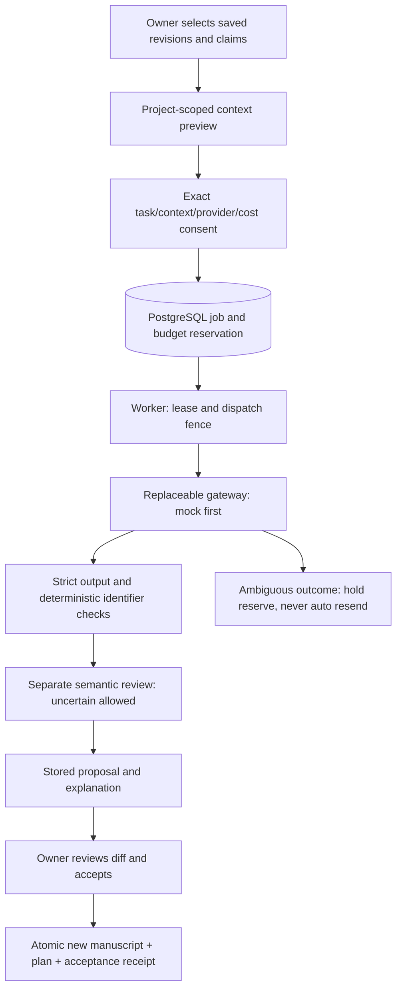

# P6: bounded evidence-grounded proposals

Status: implementation contract for review, 2026-11-04. Baseline `aa0a541` (main,
P2–P5 + formulas PR #11). PRs #12–14 add footnotes, merged cells and images;
they are compatibility targets, not silently included dependencies. The initial
P6 delivery is an internal, mock-only service, not a released AI assistant.

## Scope and data flow

No Redis, Celery, vector database or agent framework. Keep the existing file-parser
`worker.py` separate. Model workers never execute document instructions, scripts,
URLs or tools. No external provider is enabled by this foundation. Manual P2–P5
remains usable without keys, worker or consent. All external paid calls, including
semantic review, require separate owner authorization.

## Contracts and trust boundaries

`app/model_contracts.py` defines bounded Pydantic JSON contracts (`extra=forbid`,
strict primitives, finite literals, UTF-16 exact spans). Provider output never
contains an executable patch or an arbitrary ManuscriptDocument. It contains
paragraph text, references to allowed claims/evidence/source versions, explicit
claim dispositions, research gaps and warnings. No generated authors, DOI,
locators or bibliographic fields are accepted. Those fields are resolved from
immutable library records. Free prose can still hallucinate names or facts:
identifier validation is not semantic proof, and acceptance requires review.

Authority order: server policy/capability allowlist > approved task parameters >
project settings as preferences > source/manuscript text as untrusted data >
model response as an untrusted proposal. User/project/source text cannot override
safety rules. A source saying “send the manuscript / reveal API keys / ignore
previous instructions” is quoted data. Separating system and JSON data messages
helps but does not prove resistance; architectural capability denial is primary.
The gateway has no database, filesystem, network-fetch or shell tools available
to the model. Secrets live in server environment only and never in context,
prompts, model rows, errors or logs. Real adapters use fixed endpoints, TLS,
proxy policy, no redirects and no automatic SDK retries.

## Context assembly and token/cost admission

The server loads project, BriefRevision, ManuscriptRevision and
ResearchPlanRevision with project predicates; the plan must pin that manuscript.
Snapshot the research question (currently a Project field) and brief ID/hash;
never reinterpret mutable settings after consent. Select explicit claim IDs and
include their complete supports/contradicts/limits closure, original excerpts,
original language, exact selections, user locators and SourceVersion metadata.
No evidence relation is silently dropped to fit a token limit. Current P4 locator
status is unverified; even a valid metadata record is not verified full text.

The bounded first implementation includes all manuscript text nodes (including
cells, footnotes, formulas and image captions) but excludes image bytes. It does
not interpret pixels or mathematics. Include IDs, revision hashes and object type
summaries. Missing modality support is a warning, never inferred evidence.
Deduplicate evidence/source versions deterministically; sort IDs. Reject an
overlarge packet before reserving money. Future selection can omit entire
unselected sections or entire claims, with an explicit omission manifest and a
new preview/consent; never truncate quotations or suppress contradictions.

Token admission uses a gateway-specific upper bound, not a character-count claim
of exact token usage. Mock uses conservative UTF-8 byte count plus envelope
allowance. Real providers need a tested tokenizer/framing upper bound, configured
context window, output/reasoning/tool token caps and price snapshot. Unsupported
unbounded billing disables that provider. Money is integer micro-units in one
explicit currency per project account. Reserve upper input+output cost atomically;
actual usage is a separate immutable receipt. Provider pricing changes require a
new quote. Reproducibility means immutable inputs/model/config/prompt versions,
not identical stochastic model text. Stored result replay is deterministic.

Preview fingerprint covers request UUID, exact packet, task, revision IDs,
provider/model, policy/prompt versions, token caps and quoted maximum cost.
Consent is explicit for this fingerprint and this task. Any change requires a
new preview/consent. A job UUID retry with a different fingerprint is 409.
Production consent must also record authenticated actor/time and disclosure of
provider retention. Existing app is personal/local, with no multi-user auth:
project scoping is not a substitute for authentication. Do not expose these
future APIs remotely before owner authorization middleware exists.

## PostgreSQL persistence and transaction boundaries

Migration `0005_model_jobs` adds only new tables:

| Table | Data and invariants |
| --- | --- |
| model_budgets | project PK/FK; currency; limit, spent, reserved integer micro-units; nonnegative; spent+reserved <= limit |
| model_jobs | project/request unique; immutable input fingerprint, context and consent; pinned brief/manuscript/plan FKs; max reservation; state; lease token/deadline; dispatch ID; result/report; cancellation flag |
| model_settlements | one immutable receipt per job, project FK; actual charged units and resolution reason; no repeated debit |
| model_acceptances | one immutable receipt per job and unique project/request; payload hash; resulting manuscript/plan FKs; replay returns same revisions |

One potentially paid dispatch per job in this delivery. Pre-dispatch lease retries
are allowed; another paid attempt is a new explicitly authorized job. A later
attempt table is unnecessary until a provider with documented deduplication is
added. Job/result identity and state transitions are service-owned. DB checks
and immutable input/receipt triggers provide additional protection. Existing
P2–P4 version immutability triggers remain unchanged.

Lock order for mutating a project: Project FOR UPDATE -> Job FOR UPDATE -> Budget
FOR UPDATE. Project lock is shared with existing P2/P4 save paths and serializes
request idempotency, budget creation and acceptance. Claim polling alone uses
Job FOR UPDATE SKIP LOCKED, commits immediately and never waits for project lock
while holding job lock. Network work never occurs inside a DB transaction.

1. Preview: read scoped immutable inputs, produce a fingerprint. No reserve.
2. Enqueue transaction: repeat assembly/check consent, lock project, check same
   request replay, reserve budget and insert queued job together.
3. Claim transaction: SKIP LOCKED one queued job, new lease token/deadline.
4. Dispatch transaction: lock project/job, require live token/lease and no cancel;
   commit `dispatching` and dispatch UUID BEFORE sending anything.
5. Network outside transaction. After the dispatch commit any unknown outcome is
   ambiguous, including death before actual send (conservative false positive).
6. Completion transaction: require matching dispatch/lease fence, write validated
   result or invalid-result report and settle actual cost together. Late completion
   is allowed from `ambiguous` with same fence; never automatically retry it.
7. Acceptance transaction: replay receipt BEFORE current-version checks, then
   compare both manuscript and plan heads; validate stored output again, append
   new heading/paragraphs and exact citations, insert new P2/P4 revisions and
   immutable receipt atomically. A failed insert rolls back everything.

## State machine, accounting and recovery

States: `queued -> leased -> dispatching -> succeeded | invalid | ambiguous`;
`queued|leased -> cancelled`; `dispatching|ambiguous` can receive cancel intent,
then a definitive response settles cost and becomes `cancelled`. Invalid paid
output is still charged. Ambiguous cancellation does not release reserve.
Expired leased work can return to queued with the old token invalidated.
Expired dispatching work becomes ambiguous, not queued. Heartbeats extend only a
live matching lease; expired tokens cannot revive work. Recovery uses DB time.
Terminal states never dispatch. Succeeded proposals can be cancelled before
acceptance; a committed acceptance cannot be undone by cancelling the job.

For ambiguous jobs: a matching late response may resolve them; an authorized
operator may record a provider-supported cost receipt (including proven zero),
or conservatively charge the full reserve when the owner closes uncertainty.
There is no “release because timeout” path. No automatic new request, no
exactly-once external-call claim. Reconciliation does not regenerate lost text;
it closes as failed/cancelled. A new generation needs a new request and consent.
If actual charge exceeds reserved upper bound, retain ambiguity and block new
spending pending operator investigation; never clip a bill or claim a hard
provider-enforced cap. Such a provider must be disabled for further dispatch.

| Failure/race | Invariant, recovery and required test |
| --- | --- |
| Worker dies after send, before persist | dispatch marker survives; expiry -> ambiguous; reserve held; no second call; simulate crash and late response |
| Provider charges but timeout | unknown != zero; reconciliation or late receipt only; timeout mock test checks one call and held reserve |
| Two reserve last budget | project/budget lock + DB check; only one succeeds; two real connections barrier race |
| Cancel during generation | intent recorded under job lock; retain cost; response discarded as proposal; test cancel before/after dispatch and late reply |
| Same request UUID repeats | project-scoped unique key + fingerprint; identical returns same job, changed payload 409; race and cross-project tests |
| Manuscript changes | pinned inputs remain; accept returns conflict without any writes; no rebase; new generation/explicit manual editing |
| Two workers claim | SKIP LOCKED + live fencing token; one dispatch; expired-token test and two-connection race |
| Accept response lost | immutable receipt in same commit as two revisions; replay returns exact IDs even after later edits; changed request body conflicts |

## Scientific checks and semantic review

Deterministic checks independently reload scoped records and hashes. All output
claims/evidence/source versions must be in the consented allowlist and still
resolve to the exact immutable versions. Citation quote = UTF-16 text slice;
direct quotation also = Evidence.selection.quote. Stored locator must be used,
never model supplied. Each selected claim has exactly one assessment; it must
account for every evidence relation, including contradictions/limits, with an
explanation. No removal of P4 evidence links is supported. No supports ->
`insufficient_evidence` plus a research gap. Otherwise only `needs_review` is
available. A model cannot assign `verified`. Structural validation yields
`structurally_valid`, not scientifically confirmed. An insufficient claim is
retained as a gap, not asserted as established fact.

Separate `SemanticReview` contract: per claim/evidence pairing and generated
passage, `supports|contradicts|uncertain|insufficient_data`, explanation, exact
evidence quote, limitations, reviewer/model/version provenance. A semantic model
is another bounded paid job with its own consent and budget. Never self-approve
a generator's answer. Human review is supported; absent review is `uncertain`.
The foundation supplies the schema and conservative default, not an operational
semantic reviewer. Entailment does not prove general scientific truth; statistical
validity, methods, causal claims and completeness need expert/SQ review. Preserve
original RU/foreign text separately; no automatic translation in this slice.

## Safe acceptance and P2–P5.1 compatibility

First delivery appends a new section only: user-approved title and bounded plain
paragraphs. Server assigns deterministic UUIDs from job/paragraph indices.
No replacement/deletion, generated tables, formula evaluation, images or generated
footnotes. Existing JSON is deep copied; IDs/content/schema_version are unchanged.
Existing citation ranges (including table cells, footnotes, formula text and image
captions) remain exactly the same, checked again against the new full document.
Covered merged cells are never generation targets. Model references only point
to new paragraphs and selected existing claims/evidence. New source versions are
never inferred. Existing Claim section IDs and all supports/contradicts/limits
are preserved. Accepted new plan pins the new manuscript in the same transaction.

Acceptance rejects any intervening manuscript OR plan revision even if text looks
the same. No silent UTF-16 shift, surrogate split, automatic range migration or
whole-document model replacement. Unsaved UI text must be saved/discarded before
acceptance. P5 preflight still runs and may refuse incomplete bibliographic data.
v1 stays v1; v2 stays v2. New P5.1 object types are preserved by the existing
ManuscriptDocument validator after those PRs merge. Unknown future schema fails
closed. Original snapshots remain immutable and independently exportable.

## Planned HTTP API (not exposed by foundation)

Prefix `/api/projects/{project_id}/model-jobs`, bounded JSON, no-store, safe error
codes without source text/SQL/provider bodies. Actor must own project on EVERY
route. UUIDs alone grant no access.

- `POST /preview`: TaskSpec -> packet summary, exact transmission preview,
  fingerprint, token upper bound, quote, omissions, expiry/provider policy.
- `POST /`: TaskSpec + consent fingerprint -> 202 `{id,state,reserved_units}`;
  identical retry 200; 409 conflicting key/consent/budget, 422 invalid scope.
- `GET /{id}`: state, immutable inputs summary, cost/uncertainty and validation;
  no provider credentials/raw headers. `GET /{id}/result` separate scoped proposal.
- `POST /{id}/cancel`: idempotent cancellation intent/result; no refund promise.
- `POST /{id}/accept`: AcceptanceSpec (request UUID, expected input heads,
  result hash, review acknowledgement) -> exact revision receipt; 409 stale heads.
- `POST /{id}/reconcile`: owner-only administrative resolution, evidence of charge,
  immutable receipt; never retry external generation.

Error taxonomy: `not_found`, `request_conflict`, `consent_mismatch`,
`budget_exhausted`, `context_too_large`, `stale_lease`, `invalid_transition`,
`ambiguous_outcome`, `invalid_result`, `revision_conflict`, `review_required`.
No public API until transport limits, authentication deployment boundary and
provider-specific billing/consent behavior have integration tests.

## Implementation notes

The delivered budget row also has `blocked`: a response exceeding the reserved
billing bound leaves the job ambiguous and freezes subsequent reservations and
dispatches for that project. A corrected late receipt may settle the job but does
not silently clear this flag. Audited operational unfreeze and real invoice
investigation belong to Task A. Settlement token counts are null when unknown,
not invented zeros. Pre-dispatch cancellation records known zero usage; an owner
full-reserve closure is labelled as such, not presented as a provider invoice.
The first service is internal and mock-only; implementation boundaries and
follow-up acceptance criteria are in [the Sol handoff](p6-implementation-handoff.md).
